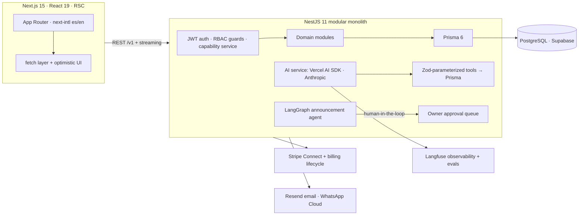

# DojoFlow — Engineering Showcase

**Gustavo Carrillo · Senior Full-Stack Engineer · [g.yokebed@gmail.com](mailto:g.yokebed@gmail.com)**

[**▶ Try the live demo**](https://dojoflow.mx/en/demo) · [**Live product**](https://dojoflow.mx) · [AI case study](docs/case-study.md) · [Architecture](docs/architecture.md) · [How I build with AI](docs/how-i-build-with-ai.md)

> I architected, built, and run **DojoFlow** — a production multi-tenant SaaS for martial arts schools — solo, end-to-end: Next.js 15 frontend, NestJS 11 API, PostgreSQL on Supabase, Stripe + manual Mexico-first billing, WhatsApp/email communications, and an **AI Owner Copilot** with tool calling, streaming, multi-agent workflows, evals, and observability. This repo is a curated, public window into that private codebase.

---

## The numbers (audited 2026-11-02)

| Metric | Value |
|---|---|
| TypeScript in production codebase | **124,300 LOC** (68.3K client · 54.3K server) |
| Automated tests | **835** (733 Jest server · 102 Vitest client) — all green, gated in CI |
| Prisma schema | 1,235 lines · 44 models · multi-tenant, multi-vertical |
| Development span | 14 months, 1,335+ commits, ~230 PRs — solo, spec-driven |
| AI eval suite (golden dataset) | **7/7 scenarios** vs the real Anthropic API · $0.083 full run |
| Production | Vercel (client) + Render (API) + Supabase (Postgres) · gated deploys |

## What DojoFlow does

A school owner runs their entire dojo: students and families, belt progression with promotion history, RRule-recurrence class scheduling, attendance, memberships with cash/transfer/Stripe billing (grace periods, expiry sweeps, renewal reminders), events and tournaments, transactional email + WhatsApp, and an AI layer that answers questions in plain language and drafts announcements that **never send without human approval**.

## Architecture

Full detail: [docs/architecture.md](docs/architecture.md) · Decision log: [docs/adr/](docs/adr/)

## Code exhibits (read-only excerpts from the private repo)

Each file carries a provenance header with the source commit.

| Area | What to look at | Files |
|---|---|---|
| **AI Copilot** | Tool calling with Zod contracts, max-tool-call guardrail, structured outputs, streaming bridge into Express | [`code/ai-copilot/`](code/ai-copilot/) |
| **Agents** | LangGraph Draft→Review graph, bounded retries, model-call ceilings, **tenant-isolation concurrency test** (input-derived mocks) | [`code/agents/`](code/agents/) |
| **Auth & RBAC** | Roles guard + capability service (OWNER/ADMIN/USER, multi-role accounts) + tenant spec | [`code/auth-rbac/`](code/auth-rbac/) |
| **Platform** | Prisma service: pool sizing for PgBouncer session mode, raw-SQL helpers, graceful shutdown | [`code/platform/prisma.service.ts`](code/platform/prisma.service.ts) |

The complete system — 44-model schema, 30+ modules, the full test suite, CI/CD — lives in the private repository. **Time-boxed read access available on request.**

## Engineering practices

- **Quality gate in CI** (lint → 835 tests → build) that deploy workflows *require* before shipping to Render/Vercel — [ADR-0007](docs/adr/0007-monorepo-quality-gate.md)
- **Spec-driven development**: every non-trivial change starts as a written spec + plan before a line of code — [How I build with AI](docs/how-i-build-with-ai.md)
- **Deterministic deploy pipeline**: lockfile-driven installs, runtime pins, cold-state verified (see [ADR-0008](docs/adr/0008-deterministic-deploys.md))
- **Secret hygiene**: full-history gitleaks scan clean; `.env` files never committed
- **ADR culture**: the interesting decisions are written down — [docs/adr/](docs/adr/)

## AI, end to end

The Copilot isn't a bolt-on demo: tool calls hit the real multi-tenant database through Zod-validated contracts; streaming renders token-by-token with stop/error states; announcement drafting runs a bounded multi-agent graph whose output **pauses for owner approval** as a database state transition; every model call is traced in Langfuse; and a golden-dataset eval (`npm run eval:ai`) reports pass rate, latency, tokens, and cost per scenario — 7/7 at $0.083 per full run. Full story with numbers: **[docs/case-study.md](docs/case-study.md)**.

---

*This repository contains curated excerpts and documentation. The product code is proprietary; exhibits here are shared for engineering evaluation. See [LICENSE](LICENSE).*
